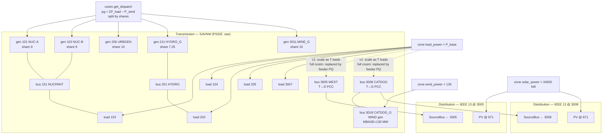
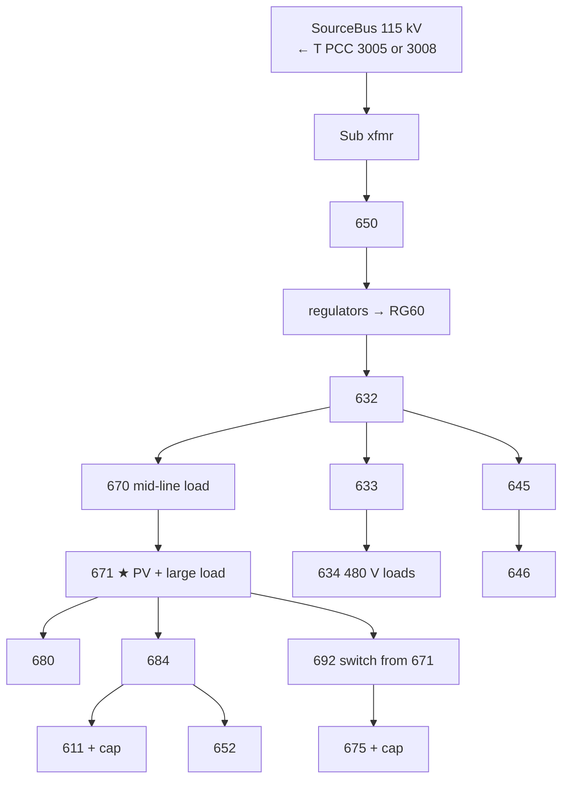

# Congestion / UC / Storage — learning pipeline (forecast → network decisions)

## Goal / motivation

This folder is a **hands-on learning path** for ones without a power-systems background** who wants to study the PSML open-source repo and internalize concepts. Forecast accuracy is secondary; the point is the chain **forecast → map → power flow → decisions**.

### No PSS/E / OpenDSS here

The original PSML **Joint Simulation** uses **PSS/E** (transmission) + **OpenDSS** (IEEE 13 distribution feeders). We **do not have access** to those tools, so:

| Original PSML | What we do instead |
|---------------|--------------------|
| PSS/E on full SAVNW `.raw` | **pandapower** on a **simplified SAVNW-like** net (same named load/gen/wind buses; reduced lines) |
| OpenDSS IEEE 13 @ 3005 / 3008 | **Ignored** (`ignore_feeders: true`); 3005/3008 stay ordinary T loads |
| `cosim.get_dispatch` in PSS/E | Same share weights in pandapower before `runpp` |

Topology diagrams below still show full T+D for studying the original repo.

## Simplified pandapower net vs PSS/E SAVNW (what differs)

### Side-by-side

| | **PSS/E + OpenDSS (PSML cosim)** | **Our pandapower Step 3** |
|--|----------------------------------|---------------------------|
| Tooling | Commercial PSS/E (Windows) + OpenDSS COM | Open-source **pandapower** on Mac/Linux |
| Network | Full `savnw_*.raw` (~23 buses, multi-kV, transformers, shunts, parallel circuits) | **13 buses / 15 lines**, all modeled at **230 kV** |
| Distribution | Two IEEE 13 feeders at 3005/3008; iterative T↔D | **None** — 3005/3008 are plain T loads |
| Branch R/X / ratings | `.raw` has R, X and **RATE1/2/3** (normal / emergency / extra limits). e.g. `153-154`: R=0.005, X=0.045, RATE1=300, RATE2=350, RATE3=1 (placeholder) | Hand-coded in `powerflow.py` (not auto-imported). For `153-154` we use that R/X and **RATE1 only** → one `max_i_ka`. No RATE2/3. Other lines are approximate |
| Dynamics | Optional ms transient (`dynsim`) with `.dyr` models | Steady-state `runpp` only |
| Outputs | Bus V, branch P/Q on full topology; feeder voltages | Same *kinds* of tables on the reduced net |
| Purpose | Publish realistic-ish PMU / event datasets | Learn the **forecast → injection → flow → decision** loop |

Numbers / loadings from our run are **illustrative on the toy net**. They will **not** match PSS/E `pf_result_*.csv` bus-for-bus — topology and impedances differ.

### Where we simplified

Implemented in `src/powerflow.py` → `build_simplified_savnw_net()`:

1. **Kept** load / gen / wind buses plus intermediate **151 (NUCPANT)** and **201 (HYDRO)** so nuclear gens and hydro attach more like the RAW (`101/102→151→153`, `211→201→203`).
2. Still **dropped** other RAW buses (152, 202, 204, 3001–3004, 3006, …) and the true **500 / 21.6 / 18 / 13.8 kV** layers — everything sits on one **230 kV** teaching mesh (no explicit transformers).
3. **Shunts are versioned** (see below).
4. **Line R/X and MVA ratings** are teaching approximations, not a verified RAW import.
5. **Kept** PL/QL load bases and **cosim dispatch shares**.

### v1 vs v2 shunts (voltage support experiment)

| Version | Config | Fixed shunts (RAW `BL`) |
|---------|--------|-------------------------|
| **v1** | `include_shunts: false` (default) | None — loads + gens + lines only |
| **v2** | `include_shunts: true` | 151 reactor (−600), 154/201/205 caps (+300), 203 cap (+50) |

```bash
# Compare both (writes outputs/powerflow/v1/, v2/, shunt_voltage_comparison.json)
python run_pipeline.py --steps map,powerflow --compare-shunts
```

Hypothesis: capacitors on **154 / 203 / 205** raise `vm_pu` there; **3008** has no RAW shunt, so any change is **indirect**. Check `outputs/powerflow/shunt_voltage_comparison.json` after a compare run.

Sample compare (same forecast row0 / +1h) — **proves capacitors lift voltage**:

| Bus | v1 `vm_pu` (no shunt) | v2 `vm_pu` (with shunt) | Δ |
|-----|----------------------|-------------------------|---|
| 154 | 0.882 | 0.948 | **+0.066** |
| 203 | 0.851 | 0.928 | **+0.077** |
| 205 | 0.896 | 0.959 | **+0.063** |
| 3008 | 0.920 | 0.957 | **+0.037** (indirect) |

So missing capacitors in v1 were a real contributor to the low `vm_pu` estimates on those buses.


## What this analysis provides

Example run: forecast origin `2018-12-01 00:00`, horizon **+1 h**, scale ≈ **0.78**, wind ≈ **0.23 MW**, then Steps 3–4.

| Finding in `outputs/` | Concept it teaches |
|--------------------------|----------------------------------------------|
| Total mapped load ≈ **1735 MW**; gens split by shares `[9,9,10,7.25,10]` | Net load & **proportional dispatch** after renewables. Forecast → “how hard do conventional units work?” without a market model |
| Line **`153-154` ~163%** loading (`n_lines_over_alert: 1`) | **Congestion** = branch above thermal rating, not “all loads bad”. Flags a **corridor** to watch; Ranked stressed lines are in `res_line.csv` |
| Buses **154, 203, 205, 3008** below 0.95 pu | Voltage band / **under-voltage** risk. Same forecast can stress **V** and **I** differently; both matter |
| Storage action **−50 MW** (discharge) because net load high / line stressed | Couple PF metrics to a **simple policy**. Prototype “if congested or high net load → discharge” for dashboards / what-if change thresholds, horizon or forcast row and see action flip |
| Pipeline map→PF→decisions in seconds | Fast **scenario sandbox**. Sweep horizons (1 h vs 24 h), U/L intervals, or another zone CSV without waiting on co-sim batches |

We practice turning a **time-series forecast** into **network KPIs** (loading %, vm_pu, toy actions) so we can plot, threshold, and compare across scenarios.

## Metrics Notes

All of these come from **one solved operating point** (one forecast row / horizon on the simplified net). Units: **MW** = megawatts (power); **%** = percent of a line’s thermal limit; **pu** = per-unit voltage (1.0 ≈ nominal).

### From Step 3 — `res_line.csv` / `res_bus.csv`

| Metric | Meaning | How it is obtained |
|--------|---------|-------------------|
| `loading_percent` (per line) | How hard that **branch** is loaded vs its rating | pandapower after `runpp`: roughly \(\|I\| / I_{\max} \times 100\%\) (also reflects the MVA rating we set when building the line). **100%** = at limit; **>100%** = overloaded in this toy model |
| `max_loading_percent` | The **worst** line in that solve | `max(loading_percent)` over all rows in `res_line.csv` — **not** an average, and **not** related to bus load PL |
| `vm_pu` (per bus) | Bus voltage magnitude | `res_bus.vm_pu`; band in config is usually **[0.95, 1.05]** |
| `p_from_mw` | Active power leaving the line’s from-bus end | Sign shows direction; used for ranking stressed corridors |

### From Step 4 — `decisions.json` / comparison

| Metric | Meaning | How it is calculated |
|--------|---------|----------------------|
| `loading_alert_percent` | **Threshold** (config, default 100), not a result | Flag a line if `loading_percent ≥ loading_alert_percent` |
| `n_lines_over_alert` | Count of congested lines | Number of lines with `loading_percent ≥ alert` |
| `n_buses_outside_voltage_band` | Count of voltage violations | Buses with `vm_pu < voltage_pu_min` or `> voltage_pu_max` |
| `net_load_mw` | Demand left for conventional + storage story | `Σ P_load − P_wind` from the mapped operating point (solar already folded into 3005/3008 loads in Step 3) |
| **`storage_action_mw`** | Toy battery **setpoint** for this snapshot | **+** = charge, **−** = discharge. Magnitude is `decisions.storage_mw` (default **50**). Rule: if `net_load_mw < storage_net_load_charge_below_mw` **and** `max_loading_percent < alert` → **+50** (charge); else → **−50** (discharge). Not a physical BESS model / SOC |
| `gen_targets_mw` | Conventional plant MW shares | Same as Step 3 / `cosim.get_dispatch`: residual load−wind split by `[9,9,10,7.25,10]` |

Note that `storage_action_mw` is a **policy output** driven by net load + congestion, not a measurement. 

### Quick read of a compare row

If v1 has `max_loading_percent ≈ 164` and 7 buses out of band, while v2 has lower max loading and only 2 buses out of band, capacitors (v2) improved **voltage** and eased some **thermal** stress — still on the toy net, but the metrics move in the expected direction.

## Pipeline overview

```text
PSML zone CSV (load / wind / solar + weather)
        │
        ▼
[1] forecast.py          persistence forecasts + simple intervals
        │
        ▼
outputs/forecasts/*.csv
        │
        ▼
[2] map_injections.py    scale SAVNW bus loads / wind@3018  (no feeders)
        │
        ▼
[3] powerflow.py         simplified SAVNW-like pandapower runpp
        │
        ▼
[4] decisions.py         congestion / storage / toy dispatch metrics
```

## Quick start

```bash
cd Code/Congestion_UC_Storage
# with repo venv active (pandapower installed)
python run_pipeline.py --steps forecast,map,powerflow,decisions
```

Configure paths and horizons in `config.yaml`.

## One snapshot vs many hours / days

**Default Steps 2–4 use a single operating point**, not a full December trajectory.

| Knob | Default | Meaning in the sample run |
|------|---------|---------------------------|
| Forecast origin (`--map-row`) | `0` | First test hour: `origin_time = 2018-12-01 00:00:00` |
| Horizon (`--horizon-hours` or first of `horizons_hours`) | `1` | Look-ahead **+1 h** → target time **2018-12-01 01:00:00** |
| Persistence | `ŷ(t+h)=y(t)` | Mapped load/wind scales come from the **origin** values, treated as the forecast for that target hour |


So for the default PF/decisions run: the injected scale is literally **CAISO zone-1 load/wind/solar at 2018-12-01 00:00** (after 1 h resample). History before midnight is used only to size the uncertainty bands, not to compute that mean.

Step 1 still writes **many** December forecast rows (and both +1 h and +24 h columns) under `outputs/forecasts/`. Only **one** row/horizon is mapped and power-flowed unless you loop.

**Reality / ops interest:** you usually want a **timeline** — every hour for a day, or day-ahead 24 h, or several days — to see how congestion / voltage / storage advice **changes**. That means repeating map → PF → decisions for many `(origin, horizon)` pairs (or many actual hours).

**Runtime:** on this toy pandapower net, **one** snapshot is ~seconds; **N** snapshots scale roughly **linearly** (~N × a few seconds), still far cheaper than PSML’s full T+D batch. Example: 24 hourly points ≈ half a minute–a couple of minutes; a month of hours is longer but still interactive. The pipeline does **not** yet auto-batch all rows — use `--map-row` / `--horizon-hours` (e.g. `24`) per run, or a small loop over rows.

```bash
# another single what-if: same day, +24 h column
python run_pipeline.py --steps map,powerflow,decisions --map-row 0 --horizon-hours 24

# another origin hour (row index into the forecast CSV)
python run_pipeline.py --steps map,powerflow,decisions --map-row 12 --horizon-hours 1
```

## Mapping assumptions (important)

**ISO zone ≠ SAVNW geography.** `CAISO_zone_1` (or any `ISO_zone_#` CSV) is a real zonal time series. SAVNW `AREA`/`ZONE` fields and load buses are labels on a **toy** test case. There is no published map that says “CAISO zone 1 owns buses 153–3008.”

What we assume in **this demo (v1):**

1. Forecast **one** zonal series (`CAISO_zone_1` by default).
2. Apply that **same** load scale to **all seven** SAVNW load buses (preserve `.raw` PL/QL *shares*; change only overall demand level).
3. Map that zone’s wind to bus **3018** (`× 130` MW); solar is a placeholder without feeders.
4. Results are a **scenario stress test** on SAVNW (congestion / storage behavior), **not** operational CAISO fidelity.

Swapping to `CAISO_zone_2` changes the numbers on the **same** topology; that is expected under this rule and does **not** make the map geographically “more correct.”

### Same class of assumption in the original PSML repo

PSML’s T+D co-sim (`cosim.py`) also does **not** claim geographic truth. PSS/E only ever sees per-bus scaled PQ:

`P_bus = P_base × load_ts[row][bus_index]`

Their scenarios are **richer**: each of the seven load buses gets its **own** zonal series (assigned in `PSML/Minute-level PMU Measurements/case */pf_input_*.txt`), and wind/PV indices pick which file drives gen 3018 / feeder PV. The three published cases are different **assignments of real zones onto the same SAVNW**, not three different transmission topologies:

| Case | Load-bus profile sources (`l1`…`l7`) | Wind / PV pick |
|------|--------------------------------------|----------------|
| **0** | CAISO 1–4 + SPP 6, 13, 14 | `wind_idx=2`, `pv_idx=[1,4]` |
| **1** | MISO 1–6 + PJM 20 | `wind_idx=4` |
| **2** | ERCOT 1–7 | `wind_idx=1`, `pv_idx=[4,5]` |

So: original repo = **multi-zone → multi-bus** scenario drivers on one lab grid; our demo = **single-zone → all buses** (simpler special case of the same non-geographic assumption). Forecasting benchmarks remain separate: they score zone CSVs only and do not require a correct bus map.

## Reference topologies (PSML Joint Simulation)

These are the lab grids behind `cosim.py`. **Our Congestion v1 uses only the T (SAVNW) side** and treats 3005/3008 as ordinary scaled loads (`ignore_feeders: true`). Keep the diagrams for when feeders are re-enabled.

### T+D co-simulation topology



**Attachment (from cosim setup):**

```text
env = cosim(case_T, [IEEE13, IEEE13], [3005, 3008], data)
         SAVNW.raw     two feeders         PCC buses
```

| Asset | Where it lives | Scaling in cosim |
|-------|----------------|------------------|
| Wind | T machine @ **3018** | `wind_ts * 130` MW |
| Conventional gens | **101, 102, 206, 211, 3011** (NUC-A/B, URBGEN, HYDRO_G, MINE_G) | `get_dispatch`: shares `[9, 9, 10, 7.25, 10]` of `(ΣP_load − P_wind)` |
| PV | D bus **671** (each feeder) | `pv_ts * 34500` kW |
| Non-feeder loads | T buses 153, 154, 203, 205, 3007, … | `P_base * load_ts` |
| Feeder loads | Solved in OpenDSS; PQ returned to 3005 / 3008 | not a simple T scale |

### IEEE 13-bus feeder (one copy)

Source: `Code/Joint Simulation/case_D/13Bus/IEEE13Nodeckt.dss`. In T+D, `SourceBus` is tied to transmission PCC **3005** or **3008**. Cosim places **PV at bus 671**.



Loads (kW) live at 671, 634a/b/c, 645, 646, 692, 675a/b/c, 611, 652, 670a/b/c. Caps at 675 and 611.

## Design choices (honest limits)

- **Learning project**, not research / operations software.  
- **No PSS/E / OpenDSS** — pandapower T-only stand-in.  
- **Simplified net ≠ full SAVNW RAW** — same bus names / load bases / dispatch idea; fewer lines so Step 3 stays easy to run and debug.  
- **Zone ≠ bus:** forecasts stay zonal; buses get MW only through an explicit **mapping**.  
- **Persistence forecaster:** good enough to drive the pipeline; swap later if needed.  
- **No feeders:** OpenDSS IEEE 13 ignored; diagrams above are for reading the original repo.

## References

- **PSML (original dataset & code)** — Zheng et al., *PSML: A Multi-scale Time-series Dataset for Machine Learning in Decarbonized Energy Grids*  
  - GitHub: [tamu-engineering-research/Open-source-power-dataset](https://github.com/tamu-engineering-research/Open-source-power-dataset)  
  - Dataset (Zenodo): [10.5281/zenodo.5663995](https://doi.org/10.5281/zenodo.5663995) / [record 5130612](https://zenodo.org/record/5130612)  
  - Local paths used here: `PSML/`, `Code/BenchmarkModel/LoadForecasting/`, `Code/Joint Simulation/` (incl. `cosim.py`, SAVNW `.raw`, IEEE 13 `.dss`)

- **pandapower** — open-source Python power-system analysis (we use `runpp` as a PSS/E stand-in for the T-only teaching net)  
  - Docs: [https://www.pandapower.org](https://www.pandapower.org)  
  - GitHub: [e2nIEE/pandapower](https://github.com/e2nIEE/pandapower)  
  - Paper: Thurner et al., “pandapower — an Open Source Python Tool for Convenient Modeling, Analysis and Optimization of Electric Power Systems,” *IEEE Trans. Power Systems*, 2018.
